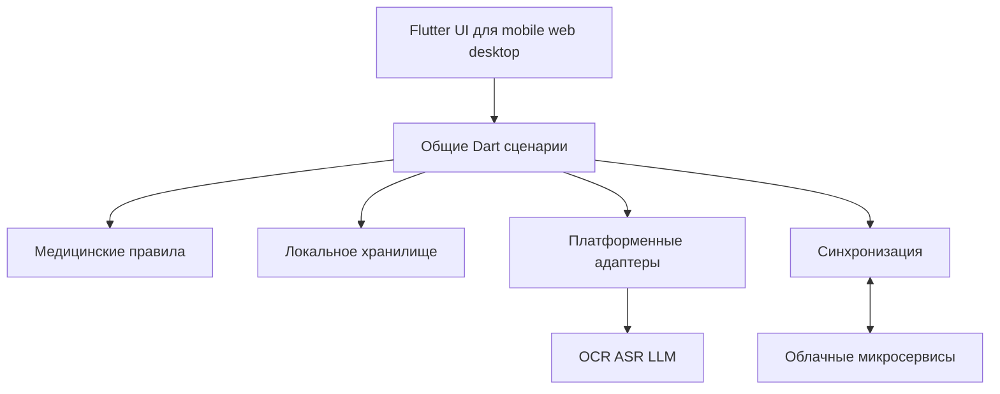

# Архитектура приложения на Flutter и Dart

Рабочий вариант от 24 ноября 2026 года: Flutter для iOS, Android, web и desktop, общее локальное ядро на Dart, независимые UI-модули, платформенные AI-реализации и облачные микросервисы с серверным OCR/LLM или внешним API. Полный выбор стека и проверки тяжёлых сценариев описаны в [ADR 0002](adr/0002-flutter-dart-shared-core.md); решения реализованного каркаса приняты в [ADR 0004](adr/0004-flutter-scaffold.md).

Архитектура пересмотрена по версии 17 прототипа и обновлениям до `af42757`. В репозитории есть демо в `index.html` и Flutter-каркас в `apps/health_app`, `medical_domain` и `design_system`. Работают оболочка в дизайне Orange of Health, демонстрационные экраны оригинала, навигация, RU/EN и локальное сохранение темы и языка. Локальные профиль, ручные результаты, курсы препаратов и домашние измерения реализованы с Drift/SQLite, историей и outbox — [ADR 0006](adr/0006-local-health-records.md). Минимальный Documents/PostgreSQL и стенд SeaweedFS OSS реализованы для оригиналов — [ADR 0008](adr/0008-originals-and-documents.md); OCR/LLM создаёт общий проверяемый черновик — [ADR 0009](adr/0009-shared-processing-draft.md). Сводка/отчёт и синхронизация подтверждённых записей с отдельным records/PostgreSQL реализованы — [ADR 0011](adr/0011-period-reports-and-record-sync.md). Остальные серверные контуры остаются целевыми. [Фактическая структура](project-structure.md).

## Платформы и сценарии

- iOS, Android и web; desktop рассматриваем для Windows, macOS и Linux. Обязательные ОС, архитектуры процессоров и минимальные версии уточняются отдельно.
- Мобильные устройства: телефоны, планшеты и складные телефоны; адаптация к размеру окна, ориентации и сгибу с сохранением состояния.
- Два языка интерфейса: русский и английский; светлая, тёмная и системная тема. Выбор хранится локально и доступен без сети. Подробные правила — в [UI-архитектуре](ui-architecture.md).
- Камера, импорт PDF и фотографий, геопозиция.
- Неизменяемые оригиналы документов локально и в SeaweedFS OSS, отдельно от извлечённых данных.
- Медицинские термины, специальности, МКБ и синонимы разных источников с локальными версиями словарей.
- Чтение, изменение и экспорт локальных данных без сети.
- Локальная обработка бланков и LLM на телефоне после установки необходимых моделей.
- Голосовой и текстовый ввод событий с проверкой извлечённых записей.
- Серверная обработка документов и результатов через собственную LLM или подключённый внешний API.
- Отдельные канальные сервисы уведомлений и коннекторы сайтов и внешних систем.
- Лабораторные результаты, профиль и анамнез, события, курсы препаратов, домашние измерения.
- Сводки, контекст на дату сдачи и отчёт врача за выбранный период.
- Подписка на облачное хранение, синхронизация устройств и ограниченный доступ врача.

[Flutter поддерживает мобильные, браузерные и desktop-платформы](https://docs.flutter.dev/reference/supported-platforms). Это определяет доступность приложения; возможности конкретных плагинов и AI-движков проверяются отдельно по каждой целевой платформе.

## Три уровня реализации

1. **Общее Dart-ядро:** медицинские сущности, правила, сценарии, обработка черновиков, запросы истории, отчёты и протокол синхронизации.
2. **Flutter UI и платформенные адаптеры:** независимые функции по MVVM, адаптивные Views, ViewModels и модели состояния; локальные драйверы, камера, файлы, покупки, геопозиция и фактическое выполнение AI.
3. **Облачные микросервисы:** учётные записи и доступы, данные и синхронизация, оригиналы, терминология, подписки, обработка OCR/LLM, каналы уведомлений и коннекторы источников.

Ядро выполняется внутри приложения через обычные вызовы Dart. Сетевое взаимодействие появляется при обращении к облаку. Облачные функции дополняют локальные сценарии.



Полная карта ядра — в [core-modules.md](core-modules.md). Подробные решения: [UI и MVVM](ui-architecture.md), [оригиналы и SeaweedFS](document-storage.md), [облачные сервисы и AI](cloud-services.md), [медицинские словари](terminology.md).

## Стек и организация кода

| Область | Рабочее предложение | Что проверить |
|---|---|---|
| Клиенты | Flutter и Dart, независимые функциональные UI-модули по MVVM | Таблицы, документы, клавиатура, мышь, доступность и навигация |
| Чистое ядро | Dart-пакеты без Flutter и платформенных импортов | Одинаковые медицинские правила на native и web |
| Локальные данные | Drift и SQLite; разные способы открытия native/web-базы | Перезапуск, миграции, транзакции, параллельные вкладки и шифрование |
| Оркестрация AI | Общие Dart-интерфейсы, отдельные backend-реализации | Формат черновика, возможности модели, отмена и память |
| Нативные интеграции | Плагины, типизированные платформенные интерфейсы и FFI | Поддержка целевых ОС и жизненного цикла |
| Серверы | Прикладные сервисы на Dart | Серверный фреймворк, переиспользование правил, эксплуатация и SDK интеграций |
| Облачные данные | PostgreSQL и закрытое SeaweedFS OSS через S3 | Владение данными сервисами, квоты и восстановление |
| Терминология | Канонические понятия, синонимы источников и офлайн-редакции словарей | Проверка соответствий, редакции МКБ и права распространения |
| Серверный AI | Оркестратор, OCR, специализированные парсеры, inference gateway и LLM/API | Качество полей, режим обработки, стоимость и ресурсы |
| Контракты | OpenAPI, схемы событий и общие примеры данных | Совместимость с ранее установленными клиентами |

[Dart pub workspaces](https://dart.dev/tools/pub/workspaces) подходит для организации нескольких пакетов в одном репозитории. Пакеты выделяются вокруг самостоятельных интерфейсов; логический модуль не обязан сразу становиться отдельным пакетом.

Flutter используется для клиентских приложений, Dart — для общего ядра и прикладных серверных сервисов. Подходящие чистые Dart-пакеты переиспользуются на клиентах и сервере; серверный фреймворк выбирается отдельно. Клиентские проверки не заменяют серверную проверку входа, доступа и квот.

## Общее ядро

Предлагаемые начальные пакеты:

- `medical_domain`: результаты, референсы, единицы, периоды, происхождение и правила сравнения.
- `medical_terminology`: локальные понятия, синонимы, соответствия источников и чтение опубликованной редакции словарей.
- `health_records`: профиль, сдачи, медицинские события, курсы препаратов, домашние измерения и сценарии их изменения.
- `document_processing`: импорт, оркестрация обработки, черновики и подтверждение.
- `health_reports`: поиск, запросы истории, сводки, контекст и данные отчёта.
- `offline_sync`: очередь, версии, конфликты и клиентский протокол синхронизации.
- `local_store`: схема, миграции и транзакции локального хранения.
- `platform_contracts`: камера, файлы, OCR/ASR/LLM, геопозиция, экспорт и покупки.

UI вызывает сценарии, а сценарии используют медицинские правила и необходимые интерфейсы. Плагины, драйверы базы и AI-движки подключаются как реализации этих интерфейсов. Строки таблиц, типы SDK и Flutter-виджеты не становятся публичными типами медицинского ядра.

Общая бизнес-логика не импортирует `dart:io`, `dart:ffi` или браузерные библиотеки. Платформенные импорты изолируются в адаптерах. Это особенно важно для web, где нативная FFI-реализация заменяется браузерной.

## Медицинские данные и время

- Результат хранит исходную запись из бланка и нормализованное значение. Поддерживаются числа, качественные ответы и сравнения вроде «меньше».
- Единицы, референсы, лаборатория, метод и происхождение относятся к конкретному результату. Сравнение значений учитывает их совместимость.
- Домашнее измерение отличается по происхождению от лабораторного результата, даже если оба относятся к глюкозе.
- Курс препарата содержит период, режим и сведения о назначении. Состояние на дату вычисляется для выбранной даты, включая курсы, начатые до первого анализа.
- Даты без времени, точные моменты с часовым смещением и приблизительные периоды представлены явно. Неуказанный день не подменяется выдуманной точной датой.
- Расчёты получают нужную дату или часы как зависимость. Последняя дата демо-анализа не является текущей датой приложения.
- AI формирует черновик. Подтверждение, ручное исправление и дальнейшая история результата являются отдельными действиями.

Идентификаторы и точные десятичные значения в сетевых контрактах передаются строками; даты и периоды имеют согласованные форматы и точность. Правила поиска предыдущего значения и границ отчёта фиксируются проверочными примерами.

## Медицинские словари

Канонические названия, специальности, МКБ и альтернативные обозначения принадлежат сервису Terminology. Ядро использует опубликованную локальную копию: источник, его код или название сопоставляются с устойчивым понятием с учётом контекста.

Исходный текст сохраняется вместе с нормализованным идентификатором и редакцией словаря. Неоднозначные названия проходят проверку. МКБ хранится с системой и выпуском; обновление словаря не переписывает подтверждённые медицинские записи. Полная схема и офлайн-обновления — в [terminology.md](terminology.md).

## Локальное хранение и синхронизация

Локальная база является источником данных для UI. Изменение и соответствующая запись исходящей очереди сохраняются одной транзакцией. Отдельно хранятся неизменяемые оригиналы документов, их метаданные, производные, версии извлечения и подтверждённые записи. Для облачных байтов выбрано SeaweedFS OSS; Documents управляет загрузкой, проверкой SHA-256, доступом, версиями и квотой. [Схема хранения](document-storage.md) предусматривает офлайн-копию, временную область загрузки и проверку восстановления.

[Drift поддерживает native SQLite на Android, iOS, Windows, macOS и Linux и WasmDatabase в браузере](https://drift.simonbinder.eu/platforms/). Общие запросы и схема переиспользуются, способ открытия и обеспечение сохранности базы зависят от платформы.

Протокол синхронизации предусматривает устойчивые клиентские идентификаторы, идентификаторы операций, серверные ревизии, курсор изменений, отметки удаления и обнаружение конфликтов относительно исходной версии. Порядок конкурентных правок определяется протоколом, а не только временем на устройстве.

Файлы передаются отдельно с возобновлением и проверкой целостности. Медицинские записи ссылаются на документ по устойчивому идентификатору; состояния загрузки и доступности оригинала представлены явно. Применение операции и обновление серверного журнала синхронизации выполняются транзакционно в сервисе медицинских записей.

Первая синхронизация связывает локальные профили с учётной записью без потери происхождения. Исправления подтверждённых результатов сохраняют историю; конфликтующие исправления требуют явного разрешения. Синхронизация выполняется при активной работе и восстановлении сети, фоновые механизмы подключаются с учётом ОС.

Подписка контролирует серверные облачные операции. Предлагаемое правило — локальная история и экспорт остаются доступны при завершении подписки. Сроки хранения облачной копии, льготный период и поведение переполненной квоты требуют продуктового решения.

## Обработка фото документов и голоса

Общий конвейер:

1. Получить локальный документ, текст или аудиозапись.
2. Извлечь текст PDF, выполнить OCR изображения или ASR аудио, если это требуется.
3. Разобрать показатели и события, сохранив связи со страницами, областями изображения или исходным текстом.
4. Проверить структуру, значения, даты, единицы и ссылки через ядро.
5. Показать черновик, принять исправления пользователя и подтвердить записи.

Одинаковый конвейер применяется к лабораторному бланку, выписке и рассказу о событиях. При этом типы данных и правила подтверждения сохраняются. Браузерная диктовка демо не доказывает доступность офлайн-ASR; поддержка локального голоса требует собственного проверенного адаптера. Серверный режим реализует тот же контракт черновика через OCR/ASR, специализированные парсеры и шлюз к собственной LLM или внешнему API. Его состав и задания описаны в [cloud-services.md](cloud-services.md).

Контракты AI задают вход, структурированный результат, возможности, прогресс, ошибку, отмену и освобождение ресурсов. Манифест модели описывает совместимую платформу, движок, версии формата и весов, размер, требования устройства и контрольные суммы. Большие веса хранятся вне Git.

Установка поддерживает продолжение загрузки и проверку целостности. Работа без сети проверяется после установки всех необходимых пакетов. Поставка базовых моделей внутри приложения остаётся отдельным решением по размеру установочного пакета.

Для native-платформ рассматриваются llama.cpp и LiteRT-LM через проверенную обёртку или собственную интеграцию. Flutter предоставляет [FFI](https://docs.flutter.dev/interop/bind-native-code) и [платформенные интерфейсы](https://docs.flutter.dev/platform-integration/platform-channels). Длительные вычисления не блокируют UI; управление потоками, изолятами или workers находится в реализации адаптера.

[llamadart](https://pub.dev/packages/llamadart) — кандидат для проверки нескольких платформ и моделей, а не зафиксированная зависимость. Его документация обозначает web-поддержку как экспериментальную. [LiteRT-LM](https://developers.google.com/edge/litert-lm/overview) также имеет различающиеся по зрелости языковые интеграции. Качество русских бланков, память, отмена, прогрев и ускорение оцениваются на физических устройствах.

## UI и платформенные возможности

UI разбит по функциям: сводка, результаты, документы, проверка черновиков, профиль, события, препараты, дневники, отчёты, справочники, доступы, подписка и настройки. Внутри функции разделены Views, ViewModels, модели состояния и локальные widgets. Общие визуальные элементы находятся в design system. [Структура UI и правила зависимостей](ui-architecture.md) описывают публичные входы функций, навигацию и тестирование.

Domain Models живут в ядре, API/Storage Models — в слое данных, UI State и ViewModels — в представлении. Веса AI-моделей относятся к исполнению AI. Соседние экраны общаются через публичные параметры и навигацию; медицинские правила и запросы используют через сценарии, без дублирования в ViewModels.

Общие экраны адаптируются под телефон, планшет, браузер и desktop. Графики получают готовые ряды и события, отчёт — согласованный набор данных за период. Сохранение, печать и передача PDF выполняются адаптерами; нужные для офлайна шрифты и ресурсы поставляются локально.

Возможности платформы представлены явно. Например, основной [плагин camera](https://pub.dev/packages/camera) заявляет Android, iOS и web; для desktop требуется отдельно выбрать реализацию. [in_app_purchase](https://pub.dev/packages/in_app_purchase) поддерживает Android, iOS и macOS; остальные способы оплаты проектируются отдельно. Поиск реальных клиник использует каталог источников, а получение геопозиции зависит от ОС и оборудования.

ViewModel получает зависимости при создании. В ней сохраняются состояние UI, команды и подписки на сценарии; ресурсы освобождаются по жизненному циклу. Редактируемые черновики и состояние синхронизации принадлежат устойчивому слою данных и не теряются при закрытии экрана.

## Web с первого этапа

Flutter web использует то же Dart-ядро. Серверные интерфейсы остаются открытыми для отдельного врачебного web-клиента, внешних интеграций или другой реализации UI, если такая потребность появится.

Офлайн в браузере состоит из загрузки приложения, сохранности данных, файлов и доступности нужной AI-реализации. [Flutter больше не создаёт кеширующий service worker по умолчанию](https://docs.flutter.dev/platform-integration/web/faq); для офлайн-запуска требуется отдельная настройка кеширования и обновления ресурсов.

[Drift web](https://drift.simonbinder.eu/platforms/web/) использует SQLite/WASM и браузерные механизмы хранения. Проверяются worker, сохранение после перезапуска, несколько вкладок, квоты и восстановление. Некоторые способы хранения требуют COOP/COEP; совместимость этих заголовков с авторизацией и внешними интеграциями проверяется отдельно.

Браузерный AI-адаптер использует подходящий web runtime. Доступность и производительность WebGPU/WASM не приравниваются к мобильному native backend. Обязательный объём локального AI в web и поддерживаемые браузеры ещё предстоит определить.

## Облачные микросервисы

Детальная схема приведена в [cloud-services.md](cloud-services.md). Прикладные сервисы: `identity`, `access-sharing`, `health-records-sync`, `documents`, `billing-entitlements`, `terminology`, `provider-directory` и `model-catalog`.

Уведомления разделены на `notification-orchestrator` и `delivery-{channel}`: Telegram, VK, MAX, email, push и другие подключённые каналы. Каждый имеет собственную очередь, конфигурацию, лимиты и состояние интеграции. Аналогично, `connector-orchestrator` управляет заданиями `connector-{source}` для каждого сайта или API; сбой конкретного источника локализуется в его коннекторе.

Серверная обработка документов и результатов — обязательный контур: `processing-orchestrator`, подготовка документа, OCR/ASR, специализированные parser-workers, `inference-gateway` и собственные `llm-runtime-{model}` либо внешние AI API. Выбранный режим обработки определяет допустимый провайдер. Результатом является версионируемый черновик с происхождением и редакцией словаря; подтверждение медицинских записей выполняется отдельно.

Каждый сервис владеет своими данными и миграциями. Stateless workers возвращают результаты владельцу задания по контракту. Важные изменения публикуются через транзакционную исходящую очередь; обработчики допускают повторную доставку. Записи и журнал синхронизации применяются атомарно внутри Health Records & Sync.

Documents хранит оригиналы в закрытом SeaweedFS OSS. Парсеры получают доступ к исходникам по заданию, а производные и повторные запуски не заменяют оригинал. Для врача доступны синхронизированные данные или снимок отчёта согласно разрешению. Отзыв доступа, ранее выданные ссылки и скачанные копии учитываются в модели доступа.

Локальные сценарии остаются автономными. Наличие серверной LLM не отменяет локальную обработку, а облачное хранение не означает автоматическую передачу документа внешнему AI API.

## Предлагаемая структура репозитория

```text
apps/
  health_app/                    # сборка зависимостей, routing и Flutter entry points
packages/
  medical_domain/
  medical_terminology/
  health_records/
  document_processing/
  health_reports/
  offline_sync/
  local_store/
  platform_contracts/
  design_system/
  features/
    documents/                   # views, view_models, models, widgets, routing
    results/
    profile/
    measurements/
    reports/
    .../
plugins/
  ai_runtime/
  document_io/
contracts/
  openapi/
  events/
services/
  identity/
  access-sharing/
  health-records-sync/
  documents/
  billing-entitlements/
  terminology/
  provider-directory/
  model-catalog/
  notification-orchestrator/
  connector-orchestrator/
  processing-orchestrator/
  inference-gateway/
workers/
  delivery/                      # отдельная реализация и deployment на канал
  connectors/                    # отдельная реализация и deployment на источник
  processing/                    # подготовка, OCR, ASR, parser-ветки
  inference/                     # серверные runtimes моделей
model-manifests/
docs/
```

Это целевая схема, а не уже созданные программные модули. Самостоятельные интерфейсы и deployments допускают общий код сборки и повторно используемые библиотеки.

## Первый рабочий срез

1. Создать Flutter-приложение, UI-функции по MVVM и Dart-пакеты; проверить сборки native, web и desktop. Каркас создан; фактические проверки и ограничения перечислены в [структуре проекта](project-structure.md).
2. Локальные профиль, ручной результат, курс препарата и измерение реализованы. Перезапуск SQLite и миграция проверены; [контракт, UI и ограничения](local-records.md).
3. Минимальный версионируемый словарь показателей и единиц подключён к ручному результату: явный выбор, исходные строки и контекст вместе с ID понятия/единицы и выпуском. [Реализация и пределы](terminology.md), [ADR 0007](adr/0007-minimal-terminology.md).
4. Минимальный путь оригинала реализован и проверен на локальном стенде: SQLite → Documents/PostgreSQL → SeaweedFS OSS → скачивание с тем же SHA-256. PDF/PNG/JPEG до 20 МиБ; [контракт, проверки и ограничения](adr/0008-originals-and-documents.md).
5. Общий черновик реализован: Tesseract → собственный Qwen/llama.cpp → общий Dart-валидатор и нормализация → правка → явное атомарное подтверждение. Локальный Mac helper и серверный Documents/Processing-контур проверены; mobile/web local runtime и внешний API пока отсутствуют. [Запуск и ограничения](document-processing.md), [ADR 0009](adr/0009-shared-processing-draft.md).
6. Сводка и полный отчёт за включительный период работают по подтверждённым данным; HTML-экспорт web/desktop и копирование текста доступны без сети. Синхронизация через отдельный records/PostgreSQL сохраняет очередь, повторяет отправку, передаёт tombstone и требует явного выбора версии при конфликте. [Контракт, запуск и ограничения](reports-and-sync.md), [ADR 0011](adr/0011-period-reports-and-record-sync.md).
7. Подключить один канал уведомлений и один внешний источник как независимые адаптеры.
8. Подключить подписку, квоты и восстановление покупки; проверить сохранность локальной истории и экспорта.

Проверки UI покрывают значимые состояния и действия; ядра — правила и время; словарей — редакции и неоднозначность; хранения — хеш, перезапуск и восстановление; синхронизации — повторы и конфликты; AI — качество полей и ресурсы. Browser и desktop входят в первый этап.

## Открытые решения

- Окончательный выбор Flutter/Dart, обязательные desktop-ОС и минимальные устройства.
- Серверный фреймворк Dart, инфраструктура сообщений и схема развёртывания SeaweedFS OSS с резервным копированием.
- OCR, ASR, локальные и серверные LLM, внешние AI API, лицензии и вычислительные ресурсы.
- Источники терминологии, нужные редакции МКБ, правила сопоставления и распространения офлайн-словарей.
- Подключаемые мессенджеры, сайты и API, их разрешённые сценарии и лимиты.
- Матрица обязательных офлайн-возможностей для web и desktop.
- Графики и PDF. Для каркаса приняты go_router, ChangeNotifier/ListenableBuilder и constructor injection; разделение по функциям и MVVM сохранено.
- Шифрование локальной базы, оригиналов и облачных данных, управление ключами и доступом врача.
- Полевое объединение конфликтов, архив удалённых записей, сроки хранения истории и квоты.
- Страны запуска, магазины, web/desktop-платежи и условия подписки.

Технические возможности и ограничения сверены с официальной документацией 24 ноября 2026 года. Версии зависимостей выбираются при реализации.
